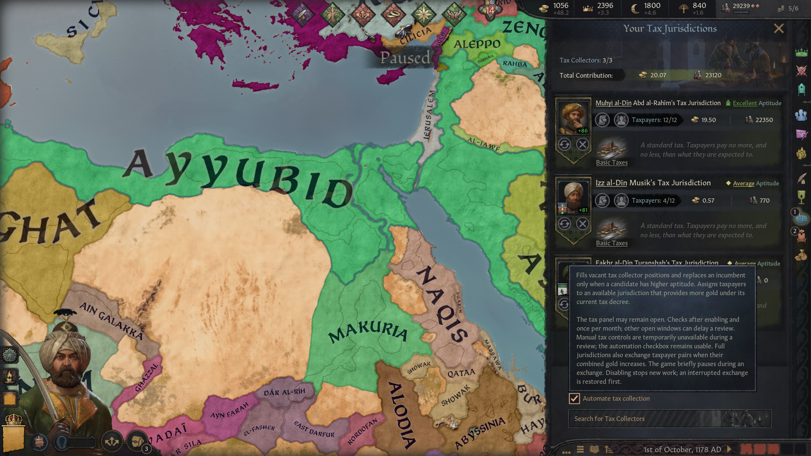

# Tax Collection Automation

## At a glance

- 🟢 **Version 0.3.0** · Targets CK3 **1.20.1.2**.
- 🟢 Standalone automation for player-controlled clan tax jurisdictions.
- 🟢 Appoints collectors and allocates taxpayers with gold income as the priority.
- 🟢 **Languages:** English, French, German, Japanese, Korean, Polish, Russian, Simplified Chinese and Spanish.
- 🔴 Pauses the game and temporarily controls the tax interface while working.
- 🔴 Income-first automation can change your existing assignments; it is unsuitable for custom allocation goals.

## Let the treasury manage the paperwork

Spend less time comparing collectors and jurisdictions. TCA aims to maximize income from the clan tax mechanic. If you prefer role-play appointments, particular taxpayer groupings or other custom priorities, keep automation off: it does not preserve those choices as constraints.

## Collector appointments and taxpayer allocation

TCA fills collector vacancies and assigns unallocated taxpayers. It can also rearrange serving collectors and already assigned taxpayers. Collector selection considers aptitude and the chosen decree; taxpayer allocation uses the game's live gold previews. Normal appointment restrictions, jurisdiction capacity and tax rules still apply. You choose the tax decrees yourself.

Enabling automation requests a review. Relevant vacancy, unassigned-taxpayer and decree changes can request further work; court arrivals and adulthood can retry vacancies. There is no monthly full optimization sweep. The income goal is not a guarantee of the global mathematical maximum.

**Why is it less seamless than Council Assignment and Court Automation?** CK3 does not expose all the required tax actions and income calculations through ordinary mod scripts. TCA must use the game's tax windows, native commands and live previews. It pauses the game, temporarily controls those windows and waits for their data to update. A review can take several seconds, especially in larger realms. Manual tax controls are unavailable during work; the previous pause/speed state is restored after completion or safe cancellation.

## Getting started

1. Enable one copy of **Tax Collection Automation** in your launcher playset.
2. As a clan ruler, choose your tax decrees, then enable **Automate tax collection** in the tax panel.
3. Let the review finish before continuing manual tax management. Other open windows can defer work.

To regain manual control, switch automation off and wait for cleanup or recovery to finish. Previously completed reviews remain; an interrupted review may roll back before returning control. After changing your preferences or decrees, enable it again when you want a new income-focused review.

## Compatibility and load order

Requires access to CK3's native clan tax jurisdictions; no other mod is required. This release targets single-player campaigns.

Replaces `hud_sidebars.gui`, `window_manage_tax_slots.gui`, `window_appoint_tax_collector.gui`, `window_tax_slot_assign_vassal.gui` and `window_tax_slot_vassals.gui`, plus `common/tax_slots/types/00_tax_slot_types.txt` and `common/tax_slots/obligations/clan_tax_collector.txt`. Mods editing the same files need a compatibility patch; load order cannot merge them.

## Saves and known limits

Back up your save before upgrading. Enablement belongs to the current player character; check it after succession or switching rulers. Before removal, turn automation off and let it finish cleanup. Completed changes are ordinary game state.

**Upgrading from 0.1.x:** finish any pending exchange in the old version before updating. An unfinished legacy exchange is held for safety, not automatically migrated into a new optimization pass. Keep the old mod and a pre-update save if recovery is needed.

Some income-improving rearrangements can be missed. Unknown custom tax decrees and overlapping tax overhauls are not covered. If a read-only preview stops responding, optional taxpayer rearrangement may be deferred after a bounded wait when the pass can safely finish. This does not bypass checks for actual assignments, and not every interrupted transaction can be recovered automatically.

## Feedback and support

Include your CK3 version, mod list, collector aptitude, tax decrees and the affected taxpayer when reporting a problem.

- [Report an issue on GitHub](https://github.com/G4VV4KH/-CK3-Tax-Collection-Automation/issues)
- Email: g4vv4kh@gmail.com

### [Want to support my work? Donate on Ko-fi 💛](https://ko-fi.com/g4vv4kh)

## Find this mod elsewhere

- [Steam Workshop](https://steamcommunity.com/sharedfiles/filedetails/?id=3815381275)
- [Paradox Mods](https://mods.paradoxplaza.com/mods/162345/Any)
- [Nexus Mods](https://www.nexusmods.com/crusaderkings3/mods/410)
- [GitHub](https://github.com/G4VV4KH/-CK3-Tax-Collection-Automation)

## My other mods

### Standalone mods

- [Parley: The Negotiating Table](https://steamcommunity.com/sharedfiles/filedetails/?id=3811090081) — negotiate diplomatic agreements.
- [Marriage Calculation Assistant](https://steamcommunity.com/sharedfiles/filedetails/?id=3811100163) — compare and sort marriage candidates.
- [Your Own Hegemony](https://steamcommunity.com/sharedfiles/filedetails/?id=3811201582) — found a custom hegemony.
- [Vassalization Extended](https://steamcommunity.com/sharedfiles/filedetails/?id=3813943691) — choose Forced Vassalization terms without a county limit.
- [Court Automation](https://steamcommunity.com/sharedfiles/filedetails/?id=3814028714) — automate court positions and recruit courtiers or knights.
- [Nomad Autorefill](https://steamcommunity.com/sharedfiles/filedetails/?id=3814793283) — automatically reinforce nomadic Men-at-Arms using herd or gold.
- [Council Assignment Automation](https://steamcommunity.com/sharedfiles/filedetails/?id=3815689627) — automate council appointments and optimize councillor assignments.
- [Strategist Assistant](https://steamcommunity.com/sharedfiles/filedetails/?id=3827659479) — plan armies, recruitment and wars.
- [Title Domination](https://steamcommunity.com/sharedfiles/filedetails/?id=3828276945) — proclaim uncreated titles through diplomacy and war.

### Compatibility patches

- [[compatch] CAA + CA](https://steamcommunity.com/sharedfiles/filedetails/?id=3816373375) — use Council Assignment Automation and Council Autopilot together.

## Credits

Cover artwork was generated with AI. The supplied tax-panel icon served as a visual reference. The interface adapts CK3's native GUI files. Mod code, text and translations are being developed with AI assistance.

## Gallery

Historical 0.1.x screenshot showing the entry point. The tooltip and automation behavior have changed in 0.3.0.

## Contributing

See [developer notes](dev.md) for implementation, validation and contribution guidance.
